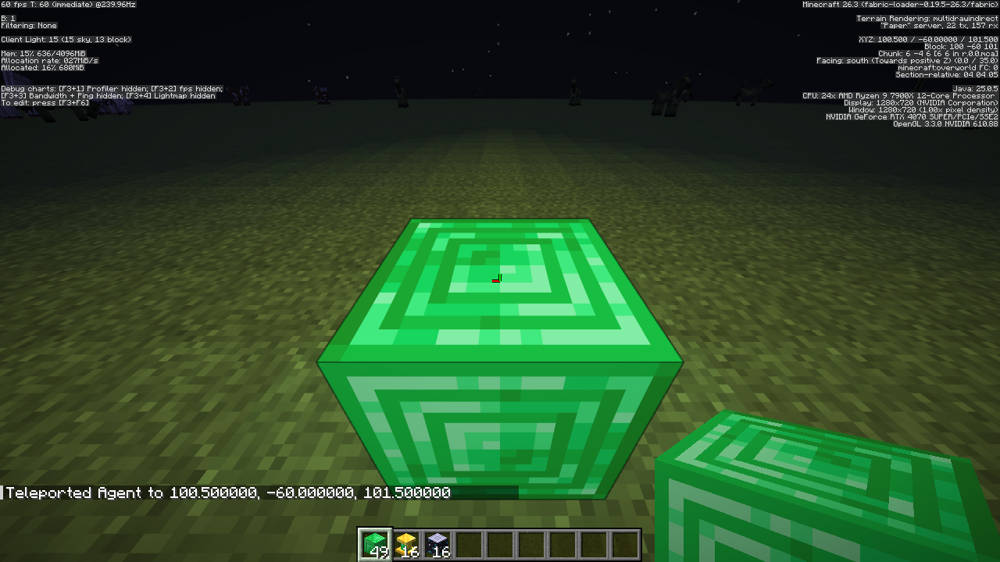

# Experimental native full blocks

The `FULL` block mechanic requires Paper or Folia 1.21.4 or newer and a working native handler. Other block types keep their existing implementations. This experimental implementation does not establish compatibility with every server fork, plugin, or vanilla block interaction.

Full blocks have native server identities. Chunk files store their native keys. Outgoing packets map their appearance to note block states that the resource pack renders. Players need the pack but no client mod. Ordinary note blocks keep their server instruments, notes, and redstone behavior.

An item can define its full block under `mechanics.block`.

```yaml
mechanics:
  block:
    type: FULL
    appearance:
      model: minecraft:block/stone
      rotation: none
    light: 0
```

`appearance.model` selects the placed model. Without it, Oraxen uses `pack.model`, then the generated item model named after the item ID. Stone in this example is an explicit model choice.

`appearance.rotation` accepts `none`, `horizontal`, or `axis`. Horizontal rotation faces the player. Axis rotation follows the clicked block face. Each orientation consumes a separate appearance allocation. Do not combine it with the legacy `directional` configuration.

New definitions do not need `custom-variation`. Oraxen assigns appearance states and persists them independently of configuration order. The current note block appearance mapping has 774 allocations shared by full blocks and their rotation variants. Existing allocations remain reserved when an item definition is removed.

`breaking` retains the block mechanic's ordered tool rules, hardness, drops, and durability configuration. Without a matching rule, hardness defaults to `1.0` and no drops are configured. `events` retains its click filters and actions. Existing Oraxen note block API methods and events also identify native full blocks. Their Bukkit block data is generic `BlockData`, so integrations must not cast it to `NoteBlock`.

With custom block sounds enabled, missing modern `sounds` actions default individually to `minecraft:block.stone.break`, `minecraft:block.stone.place`, `minecraft:block.stone.hit`, `minecraft:block.stone.step`, and `minecraft:block.stone.fall`. Modern actions use volume and pitch `1.0` unless overridden. Oraxen preserves custom sound keys exactly. For example, `sounds.place` can be a sound key or a section with `sound`, `volume`, and `pitch`. Legacy `block_sounds` keeps its existing parsing behavior.

`light` sets native emitted light between `0` and `15`. Full blocks no longer need adjacent invisible `LIGHT` blocks for this setting.

## Reproduce the pedestal example

The [item definition](examples/native-pillar.yml) and [model](examples/native-pillar.json) define an emerald pedestal with gold trim. The model uses Minecraft's emerald and gold textures, so no texture files are needed.

1. Stop the server and copy the item definition to `plugins/Oraxen/items/native_pillar.yml`.
2. Copy the model to `plugins/Oraxen/pack/models/native_pillar.json`.
3. Start the server so Oraxen registers the item and its horizontal rotation variants and generates the resource pack.
4. Join, accept the generated pack, and run `/oraxen give @s native_pillar 16` with the required permission. Use `/oraxen pack send` if the server does not send its pack automatically.
5. Place pedestals while facing different directions. Their gold front detail follows horizontal placement rotation. The example emits light level `12`, plays the configured stone placement sound, and uses the glass breaking sound. Its fallback breaking rule returns the `native_pillar` item in survival mode.

The pedestal model changes appearance. Its `FULL` block still has a full-cube collision shape.

## Startup and persistence

New native identities register during startup. Adding a full block or adding rotation variants after startup requires a server restart. Existing appearance and mechanic changes can use the normal reload flow when they do not require a new native identity. To change `light`, edit the item configuration and restart the server. Startup updates the recorded native emission, and chunk loading refreshes the light calculation. An ordinary item reload rejects light changes.

`plugins/Oraxen/native-blocks.json` is an essential part of world persistence. Back it up with the worlds, item definitions, and plugin data. Do not delete it as a cache, regenerate it from reordered configurations, or edit its keys and allocations. Restore the matching file before opening a world backup. Keep item IDs unchanged.

Oraxen restores the recorded native registrations during plugin loading, before worlds load their chunks. A missing registration can cause the server to replace an unknown saved block with air. Per-block metadata cannot reliably recover a block after the server has discarded its saved native state. Disabling or removing the plugin while opening these worlds is therefore unsafe.

## Migration of existing worlds

Keep the original explicit `custom_variation` or `custom-variation` values when upgrading legacy full blocks. They identify the old note states during conversion. Automatic new allocations do not count as evidence that a vanilla note block was a custom block.

Oraxen scans old chunks once and converts matching legacy note states into native blocks. Chunk metadata records completion. Newly generated chunks skip legacy classification. After conversion, a vanilla note matching an old custom appearance remains a vanilla note.

Legacy ordinary blocks did not store an item ID. A vanilla note with the same state as a configured legacy custom block is indistinguishable during that first scan and can also convert. Back up the worlds and matching plugin data before upgrading. Restore missing legacy item definitions before the first migration. An already migrated chunk will not repeat legacy classification when definitions are added later.

After all currently loaded chunks migrate successfully, Oraxen writes `disable-noteblock-updates: false` to Paper's configuration and restores live vanilla note updates. Later old chunks migrate when they load. A migration failure prevents the startup completion callback. Tripwire and chorus update settings remain separate and keep their existing behavior.

## Client lighting validation

A live Minecraft 26.3 client connected to Paper 26.3 confirmed a block-light baseline of `0` at an isolated location around x100, z100. Placing `native_validation` through normal item interaction raised adjacent client block light to `13` without reconnecting or injecting diagnostic light packets. The source emits `14`.



Removal, chunk reload, and chunk-boundary checks remain pending.
